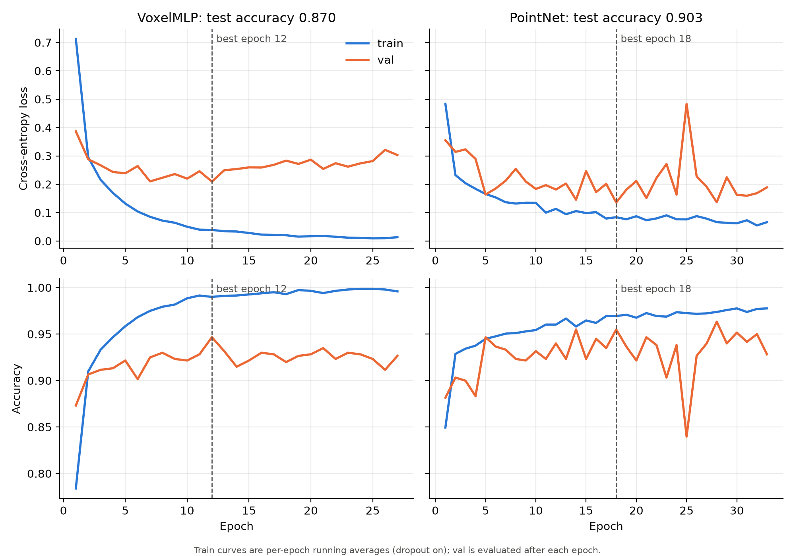
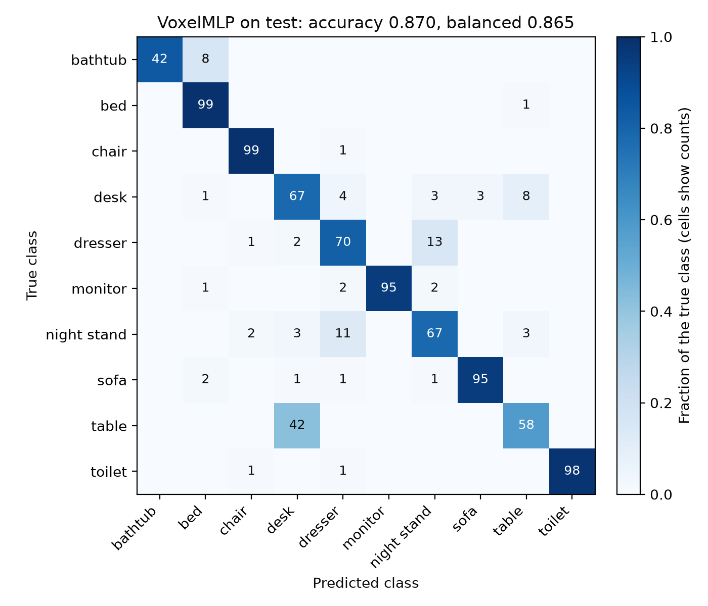

# ModelNet10 3D Object Classifier

(This README and much of the code were written collaboratively with Claude; see [AI and borrowed code](#ai-and-borrowed-code).)

> **Status: HW2.** The HW1 version of this app (the Albemarle County building-footprint viewer, with annotation and a SQLite database) is preserved at the git tag `hw1-submission`.

## Description

A web application that shows 3D CAD models of household objects and classifies them with two small neural networks. The user picks an object, sees the 3D mesh with its basic metadata, and clicks **Classify** to see both models' predicted class and their probability for every class, side by side, next to the true class. A filter lists only the objects one or both models get wrong, and a review form records a person's judgment of each object's label in a SQLite database.

This is the first step toward a longer project on 3D shape completion. Classification comes first because it builds the full pipeline: mesh loading, preprocessing, training, a backend that serves meshes and predictions, and a 3D viewer.

## Data

- **Type:** 3D triangle meshes (OFF format), each labeled with one of 10 object classes.
- **Dataset:** ModelNet10. It has 4,899 meshes in 10 classes: bathtub, bed, chair, desk, dresser, monitor, night_stand, sofa, table, toilet.
- **Citation (required by the dataset's README):** Z. Wu, S. Song, A. Khosla, F. Yu, L. Zhang, X. Tang, J. Xiao. *3D ShapeNets: A Deep Representation for Volumetric Shapes.* CVPR 2015. (arXiv:1406.5670)
- **Not included in this repo.** The meshes are kept outside the repository and are never committed (`*.off` is in `.gitignore`). The frontend never holds data; meshes reach the viewer only through the backend.
- **Label provenance** (from the 3D ShapeNets paper):
  - Categories were chosen by querying common object categories from the SUN database.
  - CAD models were collected from 3D Warehouse and the Yobi3D search engine, plus the Princeton Shape Benchmark.
  - Labels were checked first by Amazon Mechanical Turk workers, who answered yes or no to whether each model matched its category. The authors then checked every model by hand, removing irrelevant content and discarding unrealistic and duplicate models.
  - The paper's 10-category subset (the categories that overlap with the NYU RGB-D dataset) matches the ten classes distributed as ModelNet10; the paper itself doesn't use that name.
- **Orientation:** the paper doesn't describe an alignment for these models. In this project's viewer, the meshes are consistently Z-up.

### Class balance

ModelNet's own training set is imbalanced: chair has 889 models and bathtub has 106, about 8.4×. The test set is close to balanced. This is why we report macro-F1 and balanced accuracy alongside accuracy.

## Pipeline

### 1. Manifest: `src/shapes/manifest.py`

Writes `data/manifest.csv` (one row per mesh: `id, class_name, label, split, source_split, relpath`) and `data/meta.json` (class list, validation fraction, seed). Both are committed.

- **Validation split:** 15% of ModelNet's training set, stratified by class (scikit-learn `train_test_split`, seed 0). ModelNet's test set is left untouched, so the test set is never used for model selection.
- **Split sizes:** train 3,392 / val 599 / test 908.
- **The class list is stored, never re-derived**, so label numbers can't shift under a trained model.
- **Deterministic:** re-running produces a byte-identical CSV.

### 2. Mesh preprocessing: `src/shapes/pointcloud.py`

Shared by training and the backend, so the model sees the same preprocessing at prediction time as in training.

- **`load_mesh`:** loads an OFF file with trimesh and drops vertices no face uses. All 4,899 files load without errors.
- **`normalize`:** centers the mesh on its bounding-box center and scales so the farthest vertex is at distance 1.
  - The bounding-box center depends only on the object's extremes. A vertex average would be pulled toward densely modeled parts, such as a curved chair back next to legs made of a few vertices.
  - The farthest vertex gives the exact radius of the surface. Distance from a point is convex, so its maximum over a triangle is at a corner.
- **`sample_points`:** draws points uniformly from the surface.
  - It picks each triangle with probability proportional to its area, so how finely a part was modeled doesn't affect where points land.
  - It then picks a uniform point inside that triangle.
  - The sampler is written by hand (about 10 lines) instead of calling trimesh, so the area weighting can be checked by reading the code.
- **Order of operations:** normalizing, then sampling gives the same distribution as sampling, then normalizing with the same center and scale. Scaling multiplies every triangle's area by the same factor, so each triangle's share of the area is unchanged.

### 3. Point-cloud dataset: `training/build_dataset.py`

Samples 2,048 points from every normalized mesh, once, and writes `data/points/{train,val,test}.npz`. Each file contains:
- `points`: float32, shape (N, 2048, 3)
- `labels`: int64
- `ids`: the manifest ids, so any prediction can be traced back to its mesh
- `n_points` and `seed`: so each file records how it was made

The files are not committed; rebuild them with the steps below.

- Why 2,048 points when the models use 1,024: every split and both models use the first 1,024 stored points, so the comparison is on identical inputs. The extra points leave room for an optional augmentation experiment (a fresh random subset each epoch) without reloading meshes.
- **Reproducibility:** one random generator, consumed in manifest order, so a single seed reproduces every file.

### 4. Features and baselines: `training/baselines.py`

**Features: binary voxel occupancy** (`voxelize` in `src/shapes/pointcloud.py`).
- Take the first 1,024 stored points of each object.
- Divide the cube [−1, 1]³ into a 16×16×16 grid.
- Mark each cell 1 if any point falls in it, giving 4,096 features.

**Why voxels instead of raw coordinates:**
- A point cloud has no meaningful order. In a flattened coordinate vector, "position 17" is a different random point every time, so a linear model can't learn shape from it.
- A voxel grid gives the same result whatever order the points are in. It also uses ModelNet10's consistent object orientation.
- This is also why the shallow baseline uses voxels even though PointNet (below) uses points: logistic regression on raw coordinates would be meaningless for the same ordering reason.

**Same features for the baseline and the MLP.** Both models see identical inputs, so that comparison isolates one change: the hidden layer.

**Results:** numbers come from `results/baselines.json`, which the script writes.

| Model | Val accuracy | Val macro-F1 | Test accuracy | Test macro-F1 |
|---|---|---|---|---|
| Majority class (always "chair") | 0.222 | 0.036 | 0.110 | 0.020 |
| Logistic regression (L2, C = 1.0) | 0.910 | 0.858 | **0.870** | **0.866** |

- **Choosing C:** the regularization strength C was chosen on validation macro-F1 from {0.01, 0.1, 1, 10, 100}. The test set was not used for any choice.
  - The chosen model's validation score is slightly optimistic, since it's the best of five. The test score is unbiased.
- **Majority class:** accuracy is 11% on the near-balanced test set but 22% on validation, which keeps the training set's imbalance. Its macro-F1 is close to 0 on both, because it never predicts nine of the ten classes.
- **Logistic regression:** accuracy drops from validation to test, but macro-F1 doesn't (0.858 → 0.866). This points to the different class mix, not overfitting: validation accuracy is dominated by large classes such as chair, while test weights the classes almost equally.
- **What a neural network has to beat:** a test error below 13.0%. With 908 test objects, the standard error of an accuracy near 0.87 is about 0.011. So a gain of about one point would be within noise.

### 5. Models and training: `src/shapes/model.py`, `training/train.py`

Two networks, trained with the same loop. Both return logits (no softmax inside the model; `CrossEntropyLoss` applies log-softmax itself).

**Model 1: VoxelMLP** (HW2 Part 1's MLP), 1,051,402 parameters.
- 4,096 voxel features → Linear 256 → ReLU → Dropout 0.5 → Linear 10.
- The one hidden layer is the only structural difference from logistic regression. Without the ReLU, two linear layers collapse into one, which is logistic regression again.

**Model 2: PointNet (vanilla)**, 811,914 parameters. From Qi et al., CVPR 2017 (Fig. 2, without the T-Nets).
- Input: the first 1,024 stored points, shape (1,024, 3).
- Shared MLP (64, 64) → shared MLP (64, 128, 1024) → max over points → FC 512 → FC 256 → Dropout 0.3 → FC 10, with batch norm and ReLU on every layer except the last.
- "Shared MLP" means the same weights applied to every point, written as `Conv1d(kernel_size=1)`. Kernel size 1 keeps each point separate; a wider kernel would mix each point with whichever points happen to be stored next to it.
- The max over points is a symmetric function, so the output can't depend on point order. That is how PointNet answers the ordering problem that rules out raw coordinates for logistic regression.
- Why PointNet as the second model: its segmentation version reuses this backbone (the planned next assignment), and point-based encoders are a common starting point for shape completion. It changes both the input representation and the architecture, so it is a parallel approach, not a controlled comparison with the MLP.
- Vanilla (no T-Nets) to keep the model small: the paper reports 0.8M parameters for vanilla vs. 3.5M for the full model (Table 6).

**Training loop** (the steps HW2 §2.1 lists):
1. **Initialize** a fresh model for every run (PyTorch's default initialization), with every random generator seeded (seed 0).
2. **Forward:** a batch of inputs → logits.
3. **Loss:** cross-entropy.
4. **Backpropagation:** `loss.backward()` fills each parameter's gradient.
5. **Gradients:** cleared before each batch with `optimizer.zero_grad()`, since PyTorch accumulates them by default.
6. **Update:** `optimizer.step()` with AdamW (lr 1e-3, weight decay 1e-2). AdamW is gradient descent with a per-weight step size, and it applies weight decay directly to the weights.
7. **Repeat** for up to 200 epochs. After each epoch the model is evaluated on validation; training stops when validation loss hasn't improved for 15 epochs, and the weights from the best epoch are restored.

- **Batch size:** 64 for the MLP; 32 for PointNet (the paper's value).
- **Selection uses validation only.** The test set is evaluated once per model, after selection.
- **Sanity check:** an untrained VoxelMLP has validation loss 2.3030, close to ln 10 = 2.3026, the loss of a uniform guess over 10 classes.
- **Saved weights:** `backend/model/mlp.pt` and `backend/model/pointnet.pt` (committed). Each checkpoint also stores the architecture name, constructor arguments, class list, point count, grid size, and training config, and the backend refuses to load one that doesn't match its own preprocessing.

**Hyperparameters on the command line.** `train.py` takes every training setting as a flag. With no flags it reproduces the committed level-1 run exactly.
- Both models: `--lr`, `--weight-decay`, `--max-epochs`, `--patience`, `--batch-size`, `--dropout`, `--seed`.
- VoxelMLP only: `--hidden N [N ...]` (one size per hidden layer, e.g. `--hidden 512 128`) and `--activation` (relu, tanh, gelu, or sigmoid). Passing either with `--model pointnet` is an error rather than being silently ignored. PointNet's architecture is fixed.
- The defaults live in one place, `src/shapes/defaults.py`, which both `train.py` and the backend read, so the command line and the app can't disagree about what "default" means.
- Values that would crash or be meaningless (a learning rate of 0, dropout of 1, a seed outside numpy's 0 to 2³² − 1) are rejected before any data loads.
- `--out-dir DIR` writes the checkpoint, the results JSON, and `progress.jsonl` (one line of metrics per epoch, as it happens) into one folder, instead of overwriting `backend/model/` and `results/`. This is what the app's training runs use.
- If the validation loss is never a finite number (for example, a learning rate so high that training diverges), the run stops with an error instead of saving a broken model.

### 6. Web application: `backend/main.py`, `frontend/`

```
React (Vite) → /api/* → Vite dev proxy → FastAPI → PyTorch (both models, CPU) → JSON → React
```

**Backend (FastAPI).** At startup it loads the manifest, every object's stored points, and both checkpoints (checked against the manifest and preprocessing), so each request only runs inference.

| Route | Returns |
|---|---|
| `GET /objects` | Every object's id, class, and split |
| `GET /objects/{id}` | One object's metadata: split, ModelNet source split, file path, vertex and face counts |
| `GET /objects/{id}/mesh` | The normalized mesh as binary PLY |
| `POST /predict` with `{"id": ...}` | True class, plus each model's predicted class and probability for every class |
| `GET /predictions?split=...&class_name=...` | Each listed object's predicted class from each model (for the filter) |
| `POST /objects/{id}/reviews` | Saves a label review and returns the stored row |
| `GET /objects/{id}/reviews` | That object's review history, newest first |
| `GET /reviews` | The latest review of every reviewed object |
| `GET /runs/defaults` | Each model's default training settings (the level-1 config) |
| `POST /runs` | Starts a training run with the given settings; 409 if one is already running |
| `GET /runs` | Every training run, newest first |
| `GET /runs/{id}` | One run's status and settings, its per-epoch metrics so far, and its final metrics when done |
| `POST /runs/{id}/cancel` | Stops a running run |

- Predictions use the same stored 1,024 points that training used, not a fresh sample from the mesh, so a borderline object can't flip between runs. Running all 908 test objects through `/predict` reproduces the saved test accuracies exactly (0.870 and 0.903).
- Both prediction routes call one forward function, so the filter's labels and the Classify panel can't disagree.
- Inference runs on the CPU (a few milliseconds per object for both models), which keeps the GPU free for training.

**Label reviews (SQLite).** Reviews are stored in `backend/reviews.db`, created on first start.
- Each review records a verdict on the object's label (ok, wrong, or ambiguous), the class it should be when wrong, a separate mesh-problem flag (a label can be right while the mesh is broken), an optional note, and whether the model's prediction was on screen when the verdict was given. A verdict given after seeing "desk 91%" isn't independent of the model, so the record says which kind it is.
- **Append-only:** a correction is a new row, and the history keeps every earlier verdict. There's no delete route.
- **Reviews never change the dataset:** the manifest and training labels are untouched. A review is a record of judgment, not a correction.
- The rules are enforced twice: by the API (a readable 422, e.g. "wrong" without a class) and by the table's own CHECK constraints. Startup refuses a database file written for a different schema version.
- The database file is gitignored (it's user-generated state), so this repo ships no reviews; the demo video shows them.

**Training runs.** A run started from the app executes `train.py` as a separate process with `--out-dir runs/<id>/`. Each run folder holds `run.json` (the request, the exact command, status, timestamps), `log.txt`, `progress.jsonl`, and, when done, the checkpoint and results.
- **A separate process, not a thread in the server:** cancelling actually stops it (and frees the GPU), a crash or out-of-memory error can't take the server down, and the server itself stays CPU-only. Each run's saved command can be pasted into a terminal to rerun it.
- **One run at a time.** Runs never write to `backend/model/` or `results/`, so the reported models and numbers can't be overwritten from the app. `runs/` is gitignored.
- **Settings are checked before a run starts** (wrong types, unknown fields, and out-of-range values get a 422 naming the field), within caps chosen for this machine: up to 4 hidden layers of up to 5,000 units, up to 500 epochs, MLP batch size up to 4,096, PointNet batch size 2–512 (batch norm fails on a batch of one).
- **Status:** `running`, `done`, `failed` (with the last 20 lines of the log), `cancelled`, or `interrupted` (the server stopped while the run was going). A run that finished while no one was watching is still recorded as `done`.

**Frontend (React 19 + React Three Fiber).** A top bar switches between two views, **Explore** and **Train**. The view is part of the URL (`#/explore`, `#/train`), so reloading keeps it and the back button works. Switching views keeps Explore's selection, filter, Classify result, and camera angle. Explore has three panels:
- **Object picker:** class, split (test by default, since the models never trained on those objects), and a **Show** filter: all objects, any model wrong, PointNet wrong, or Voxel MLP wrong.
- **3D viewer:** the selected mesh, with rotate, zoom, and pan, under an info strip (id, class, split, file, vertex and face counts). The meshes arrive normalized to the unit sphere, so one fixed camera fits every object; ModelNet's Z-up is rotated to three.js's Y-up for display only.
- **Right panel:** an About section (the data, the models, limitations) while nothing is selected. Once an object is selected:
  - **Classify:** a table with one row per class and one column per model: a bar and percentage per cell, the true class's row marked, and ✓/✗ with the predicted class for each model.
  - **Label review:** the review form and the object's review history, newest first.
- **Train** (in progress): a form for each model, then live training curves and the finished run's metrics.

## Results

All numbers come from `results/baselines.json`, `results/mlp.json`, and `results/pointnet.json`. Seed 0; one training run per model; test evaluated once per model.

| Model | Parameters | Best epoch (stopped) | Train acc. | Val acc. | Test acc. | Test macro-F1 | Test balanced acc. |
|---|---|---|---|---|---|---|---|
| Majority class | – | – | – | 0.222 | 0.110 | 0.020 | 0.100 |
| Logistic regression | – | – | – | 0.910 | 0.870 | 0.866 | 0.863 |
| VoxelMLP | 1,051,402 | 12 (27) | 0.997 | 0.947 | 0.870 | 0.867 | 0.865 |
| PointNet (vanilla) | 811,914 | 18 (33) | 0.980 | 0.955 | **0.903** | **0.902** | **0.902** |

Train accuracy is from a separate eval-mode pass with the restored weights. Balanced accuracy is the mean per-class recall, the "avg. class" accuracy the PointNet paper reports.






- **PointNet clears the shallow benchmark:** test error 9.7% vs. 13.0% for logistic regression, a 3.3-point gain, roughly two to three standard errors. (This is rough: both models are scored on the same test objects, so a paired comparison would be the precise test.)
- **The VoxelMLP ties logistic regression on test** (0.870 vs. 0.870), even though it led on validation (0.947 vs. 0.910). It overfits: training loss falls to about 0.01 while validation loss turns upward after epoch 12, and early stopping keeps the best epoch. Its validation score is also the best point of a noisy curve, which makes it optimistic.
- **PointNet overfits less** (training loss stays around 0.06–0.08), but its validation loss is jagged from epoch to epoch.
- **Where PointNet goes wrong:** 88 errors on 908 test objects. Two confusions account for 54 of them.
  - **Table → desk (29) and desk → table (6).** Table has the lowest recall, 0.71.
  - **Dresser ↔ night stand (12 and 13).** Both are boxes with drawers that differ mainly in size, and normalizing every object to the unit sphere removes absolute size; only proportions remain.
  - Every other class has recall of at least 0.94.
- **The two models share most of their table errors:** of the 100 test tables, the MLP gets 42 wrong and PointNet 29, and 23 of those are wrong for both. Most of PointNet's table errors are also MLP errors, despite different inputs and architectures, which suggests the hardest tables are genuinely desk-like rather than exposing one model's weakness (an interpretation, not a test).
- **Probabilities are confidences, not calibrated probabilities.** For example, on `table_0398` both models predict desk, with 80% (MLP) and 91% (PointNet).

## Features implemented

- [x] Dataset manifest with stratified train/val split
- [x] Mesh normalization and area-weighted surface sampling
- [x] Preprocessed point-cloud dataset
- [x] Voxel occupancy features
- [x] Baselines (majority class, logistic regression)
- [x] Two neural networks (VoxelMLP, PointNet) with a shared training loop, early stopping, saved weights, loss curves, and test metrics
- [x] FastAPI model server with checkpoint checks
- [x] 3D mesh viewer (React Three Fiber)
- [x] Classify button with both models' class probabilities side by side
- [x] Filter for misclassified objects (any model, PointNet, or Voxel MLP)
- [x] Object info strip (file, vertex and face counts) and an About panel
- [x] Label review form with history
- [x] SQLite database of label reviews (append-only)
- [x] Training hyperparameters as command-line flags, with per-epoch progress written as the run goes
- [x] Backend routes to start, list, follow, and cancel training runs (separate process, one at a time)
- [x] Explore / Train navigation
- [ ] Interactive Training form (in progress)
- [ ] Training Monitor (in progress)

**Annotation:** yes. Each object's label can be reviewed (ok / wrong with the correct class / ambiguous), with a mesh-problem flag and a note; every review is kept.
**Backend/database:** yes. FastAPI serves objects, meshes, predictions, and reviews; label reviews are stored in SQLite (`backend/reviews.db`, gitignored).

## Libraries and frameworks

- **Python:** PyTorch, NumPy, scikit-learn, trimesh, matplotlib, FastAPI, Uvicorn
- **Frontend:** React 19, Vite, three.js, React Three Fiber, drei
- **Environment:** uv (Python ≥ 3.14, see `pyproject.toml`); Node.js and npm (exact versions in `frontend/package-lock.json`)

## Running

### Setup

```bash
uv sync
export MODELNET_ROOT=/path/to/ModelNet10
cd frontend && npm ci && cd ..
```

- `MODELNET_ROOT` is the folder that contains `bathtub/`, `bed/`, and so on, each with `train/` and `test/` inside.
- `npm ci` installs exactly the versions in `package-lock.json` (it fails if `package.json` and the lockfile disagree), so the frontend can't drift to a React version React Three Fiber doesn't support.

### Rebuild the data

```bash
uv run python -m shapes.manifest --out-dir data
uv run python training/build_dataset.py
```

The first command is only needed if `data/manifest.csv` is missing; the committed one is the canonical split. The second command takes about a minute.

### Baselines

```bash
uv run python training/baselines.py
```

This writes `results/baselines.json`. Every step is deterministic, so a rerun reproduces the same numbers.

### Train and plot

```bash
uv run python training/train.py --model mlp
uv run python training/train.py --model pointnet
uv run python training/plot.py
```

- Each training run writes `backend/model/<model>.pt` and `results/<model>.json` (metrics, confusion matrix, per-epoch history). Training uses the GPU if one is available.
- `plot.py` reads the JSON files and writes `results/figures/curves.png`, `confusion_mlp.png`, and `confusion_pointnet.png`; it doesn't retrain.
- The committed weights and results come from seed 0. Retraining overwrites them.
- To try other settings without touching the committed files, give the run its own folder:

```bash
  uv run python training/train.py --model mlp --hidden 512 128 --activation gelu --out-dir runs/my-test
```

### The app (two terminals)

Backend:

```bash
MODELNET_ROOT=/path/to/ModelNet10 uv run uvicorn main:app --app-dir backend --port 8000
```

Frontend:

```bash
cd frontend
npm run dev
```

Then open `http://localhost:5173`. The frontend calls `/api/...`, and Vite's dev server forwards those requests to the backend on port 8000, so no CORS setup is needed. If the app runs on a remote machine, forward only port 5173 (for example `ssh -L 5173:localhost:5173 <host>`).

The backend creates `backend/reviews.db` the first time it starts. Delete the file to start with no reviews.

## AI and borrowed code

- Code in this repository was written collaboratively with Claude (Anthropic). Claude drafted code section by section with explanations; I reviewed it, ran it, and checked each section's output before moving on. Design decisions were discussed and made together. TODO: refine this statement before submitting.
- **PointNet** was implemented from the paper's description (Fig. 2 and Appendix C), not adapted from the authors' code.
- TODO: list any code adapted from my earlier coursework (DS6050) or other sources.

## References

- Z. Wu, S. Song, A. Khosla, F. Yu, L. Zhang, X. Tang, J. Xiao. *3D ShapeNets: A Deep Representation for Volumetric Shapes.* CVPR 2015. arXiv:1406.5670. (ModelNet)
- C. R. Qi, H. Su, K. Mo, L. J. Guibas. *PointNet: Deep Learning on Point Sets for 3D Classification and Segmentation.* CVPR 2017. arXiv:1612.00593.
- D. Maturana, S. Scherer. *VoxNet: A 3D Convolutional Neural Network for Real-Time Object Recognition.* IROS 2015. (Background on voxel-based classification; not used in the code.)
- I. Loshchilov, F. Hutter. *Decoupled Weight Decay Regularization.* ICLR 2019. (AdamW)